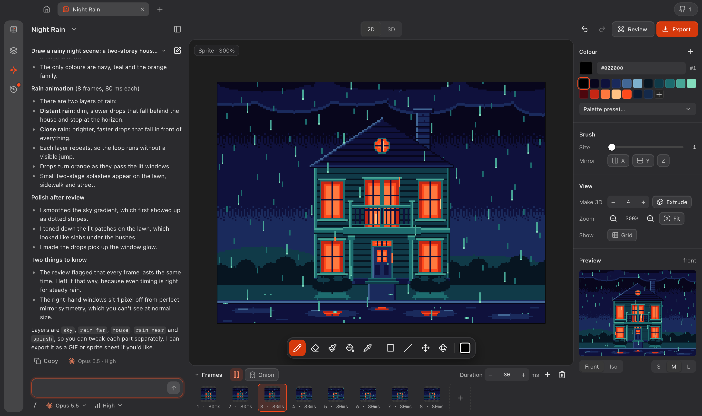

# OpenPixel

A native Mac editor for pixel art: flat 2D sprites and 3D voxel models that render to crisp sprites. It has a
built-in [MCP](https://modelcontextprotocol.io) server, so AI agents can draw, review and refine art with you.
Agent edits appear live in the open window and can be undone.

**[Download for Mac](https://github.com/sophne/openpixel/releases/latest/download/OpenPixel.dmg)** — macOS 13 or later,
Apple silicon and Intel. OpenPixel updates itself.
Until releases are notarized by Apple, macOS asks you to confirm the first launch: open the app once, then
**System Settings → Privacy & Security → Open Anyway**.



- **2D canvas**: pencil, eraser, recolour, fill, eyedropper, rectangle, line and move tools, mirror drawing, layers,
  frames, onion skin and palettes.
- **3D voxel view** with the same tools, isometric pixel-art previews, and Make 3D for any sprite.
- **Exports**: PNG, SVG, HTML, animated GIF, sprite sheets, MagicaVoxel `.vox`, OBJ.
- **Agents**: ChatGPT, Codex, Claude, Claude Code, Cursor, OpenClaw, Hermes Agent and any other MCP client. The
  Agents page in the app shows who is connected and how to set each one up.
- **Agent review loop**: every agent edit comes back with a score and the problems it introduced or fixed; agents can
  read the canvas as text (pixel grid with rulers, values, silhouette, frame diffs), lock a style for a whole set of
  assets, run many calls in one batch and review saved files side by side. They can check for updates too
  (`check_for_updates`), and are told to reconnect when the app is newer than their connection.

## Connect an agent

```sh
claude mcp add --scope user openpixel -- /Applications/OpenPixel.app/Contents/MacOS/OpenPixel --mcp
```

Other agents use the same command (`OpenPixel --mcp`) in their MCP settings. `OpenPixel --mcp-http 8765` serves MCP
over HTTP on this Mac only, for ChatGPT through a tunnel; agents connected that way can only open and save files in
`~/Documents/OpenPixel`.

## Repository

| Folder | What it is |
|---|---|
| [`app/`](app) | The Mac app: Swift package (`Sources/`), the editor UI it shows in a web view (`app/web/`), build and release scripts |
| [`core/`](core) | The core in Rust: document model, undo, every tool, rendering voxels to sprites, file formats. Builds natively (the MCP program agents start) and to WebAssembly with wasm-bindgen (one package for the desktop app and, later, a browser) |
| [`desktop/`](desktop) | The cross-platform app for macOS, Windows and Linux: Electron shell, the editor in React + Vite, the app's logic in TypeScript on top of the WebAssembly core. See [how it fits together](docs/desktop-architecture.md) |
| [`web/`](web) | The website (Next.js), deployed with Docker |
| [`.github/`](.github) | CI, CodeQL, release workflow, templates |

Build the app (needs macOS 13+ and the Xcode command line tools):

```sh
cd app
make            # OpenPixel.app
make test       # engine, MCP and file-parsing checks
make ui-test    # clicks through the editor and checks the layout
```

Build the cross-platform app (needs Node 22, Rust with the `wasm32-unknown-unknown` target, and
`cargo install wasm-bindgen-cli --version 0.2.100`):

```sh
cd desktop
npm install
npm run build:core && npm run build:mcp   # the core as WebAssembly, and the MCP program
npm run dev                               # the app, rebuilding as you edit
npm test                                  # the app logic's checks
npm run test:ui                           # the Mac app's own UI test on the old page and the React page, with pictures compared
```

`cd core && cargo test` checks the core: the engine's self-test, golden files against what the Mac app exported, and
one session run natively and through WebAssembly with every answer compared.

Run the website: `cd web && npm install && npm run dev`.

## Contributing and security

Pull requests are welcome: see [CONTRIBUTING.md](CONTRIBUTING.md). Report security problems privately as described
in [SECURITY.md](SECURITY.md). How releases work: [RELEASING.md](RELEASING.md).

## Credits

- Icons: [Lucide](https://lucide.dev) (ISC), `app/web/LUCIDE-LICENSE.txt`
- Agent logos: [LobeHub icons](https://github.com/lobehub/lobe-icons) (MIT), `app/web/agents/ATTRIBUTION.txt`. The logos
  are trademarks of their owners and only identify compatible apps.
- Updates: [Sparkle](https://sparkle-project.org) (MIT)
- Palettes: DawnBringer 16/32 (Richard Fhager), PICO-8 (Lexaloffle), Endesga 32 (Endesga)

OpenPixel is released under the [MIT licence](LICENSE).
