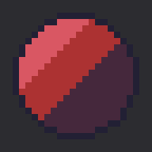
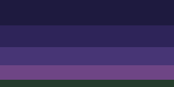
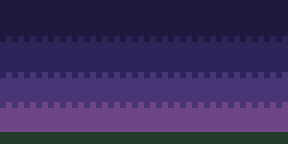
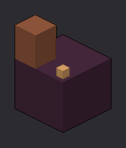
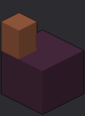

# Agent review loop: before and after

The same pixel-art scenarios were run through the engine before this change (`e5f6235`) and after it, and
the exact responses an agent receives were recorded. The pictures are rendered by OpenPixel itself.

## Static sprite: an orb

| Pillow-shaded | Relit from the top-left | After `pixel_perfect` |
|---|---|---|
|  |  |  |
| score **65** | score **80** (+15) | score **100** (+20) |

What the agent gets back after putting one doubled corner pixel back:

```jsonc
// before
{"changed": 1, "revision": 5}
// after
{"changed": 1, "revision": 5,
 "critique": {"score": 94, "change": -6,
   "introduced": ["[issue] 1 doubled corner pixel(s) in 1-pixel lines (L-shaped steps make lines look thick). pixel_perfect removes them; check the result."],
   "open": {"issues": 1, "tips": 0}}}
```

Before, the agent learned about that pixel only if it called `review_model` again; after, the edit that made the
mistake says so.

## Animation: a two-frame walk

| Frame 2 lifts the whole body | Frame 2 only swings the arms |
|---|---|
|  |  |
| ground line rows **14 → 13**: `ground_jitter` flagged | ground line **14 → 14**: not flagged |

Before, `review_model` reported nothing about the feet leaving the ground line in either version. After, the
edit itself reports it, and `view_as_text maps=["diff"]` shows what moved:

```text
          111
   3456789012        o unchanged  + filled in this frame
 0 ...++++...        - emptied    * recoloured
 1 ..+****+..
 ...
13 .+oo..oo+.
14 .---..---.        <- the feet left row 14
```

## Background: a night sky

| Hard flat stripes | Dithered band edges |
|---|---|
|  |  |
| score **95** (tip: flat stripes) | score **100** |

Full-frame backgrounds skip the sprite-only checks (canvas edge, outline, light direction), so a good background
is not marked down for having no outline.

## Voxel model: a block with a tower

| A stray voxel at (10, 8, 10) | Stray erased |
|---|---|
|  |  |
| score **91**: `introduced` floating stray | score **100**: `resolved` |

In the isometric picture the stray seems to sit on the block; it actually floats in the air. The critique
catches it at the edit; the text projections give exact positions:

```text
seen from the left (z back → front)      seen from above (x across, z back → front)
   123456789                              123456789
 9 .....###.   <- tower at the front    2 .3333333.
 5 .#######.                            6 .5553333.   <- 5 = tower colour
```

## Style drift

```jsonc
// set_pixels with "#123456" on a pico8 sprite
// before: accepted; the palette silently grows from 32 to 33 colours
{"changed": 1, "revision": 2}
// after, with set_style preset=pico8: refused with the closest locked colours
"the \"house\" style locks the palette and #123456 is not in it. Closest locked colours: 2 #1d2b53, 6 #5f574f, 1 #000000. ..."
```

The score counts only what the automatic checks measure. It does not judge the idea or appeal, and the tool
says so in every score.
